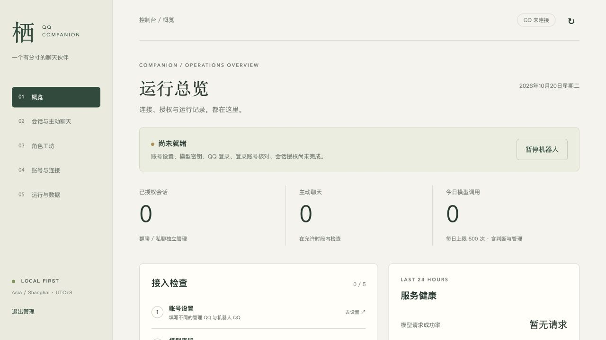
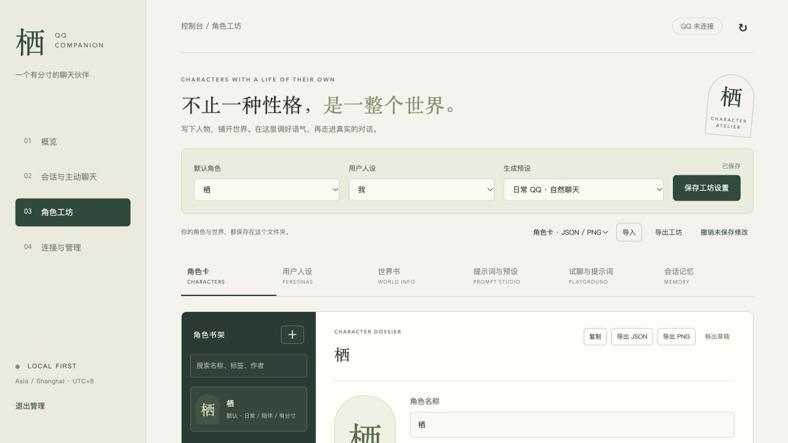
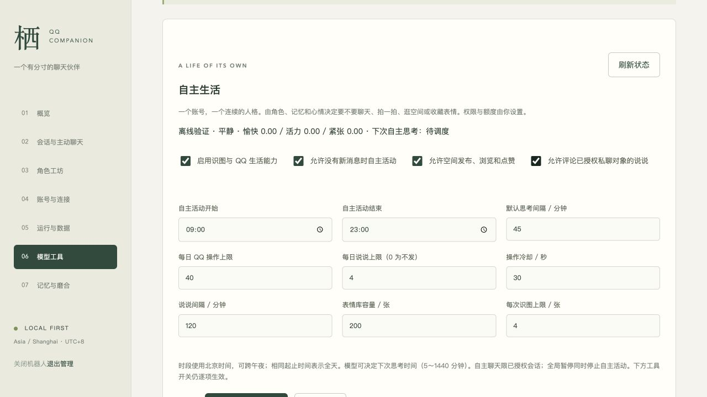

# 栖 · QQ AI 伙伴

一个运行在自己电脑上的 QQ AI 伙伴：通过 NapCat 接入独立 QQ 账号，使用 DeepSeek 进行角色聊天，并通过浏览器管理角色、记忆、会话授权和运行状态。

提供 **Windows 与 macOS 两个独立版本**，附带桌面启动器及初始角色。首次启动自动准备 Python、依赖和表情模型；使用前需自行准备机器人 QQ 账号与 DeepSeek API Key，模型调用会产生费用。

## 选择你的版本

| 平台 | 启动入口 | 环境要求 | 详细说明 |
| --- | --- | --- | --- |
| Windows | `Windows/栖.exe` | Windows x64、.NET Framework 4.8；QQ 接入需要 Docker Desktop（WSL 2 / Linux 容器） | [Windows 安装与使用](Windows/README.md) |
| macOS | `macos/栖.app` | 附带应用适用于 Apple Silicon；Intel Mac 需自行构建 | [macOS 安装与使用](macos/README.md) |

## 下载与启动

1. 点击本仓库右上方 **Code → Download ZIP**，下载并完整解压，也可使用 Git 克隆仓库。
2. 打开对应平台文件夹，双击 **栖.exe** 或 **栖.app**。保留应用与 `scripts/` 等目录的同级关系，不能只复制启动器。
3. 首次安装需要联网，等待图形窗口完成环境准备；失败后可查看日志并重试。
4. 在浏览器控制台填写管理 QQ、独立的机器人 QQ 和 DeepSeek API Key，保存后按界面提示扫码登录。
5. 选择角色，并授权需要机器人处理的好友或群聊。

**macOS 下载说明：**`.app` 是应用程序包，GitHub 会将其显示成 `栖.app/Contents` 文件夹；完整下载并在 Mac 解压后，Finder 会显示为应用。当前应用采用本地临时签名，未经过 Apple 公证，系统可能要求在「隐私与安全性」中允许打开。

关闭浏览器不会停止机器人。请通过 macOS 菜单栏或 Windows 系统托盘选择「停止机器人并退出」，也可使用控制台里的关闭入口。

## 可以做什么

- **QQ 聊天**：按授权处理私聊与群消息，支持文字、按需识图、回复等待和分条发送。
- **角色工坊**：编辑角色卡、用户人设、世界书及生成预设，支持角色导入导出和独立试聊。
- **记忆与情绪**：按角色和会话保存近期消息、长期记忆与情绪状态。
- **主动联系**：在设置的时间、间隔及额度内判断是否主动发起聊天。
- **自主 QQ 生活**：按需开启模型工具、表情收藏和 QQ 互动等功能。
- **本机管理**：在网页中完成账号配置、连接检查、授权、日志查看、备份与恢复。

## 界面预览

以下为已有开发预览截图，展示两版共用的浏览器管理界面，部分布局可能与当前版本不同；图片不代表 Windows 实机验收。

### 运行总览



### 角色工坊



### 自主 QQ 生活



## 初始内容与数据

随附「栖」「灯下的旅人」「大肥鱼」及关联世界书、生成预设，用户人设为空白「我」。首次启动自动载入，之后保留用户自己的修改。角色沿用原作者信息，分发与使用请尊重相关作者的许可。

仓库不携带原使用者的账号、API 密钥、QQ 登录状态、聊天记录、记忆、日志或备份，也不预装 Python、依赖、模型和首次下载缓存。运行后产生的配置与数据存放在对应平台目录，并由 Git 忽略规则排除。

## 文档与项目结构

```text
AI-QQ-BOT/
├── README.md          项目首页
├── 通用说明.md         双平台安装、数据与维护说明
├── Windows/           Windows 独立版本与栖.exe
└── macos/             macOS 独立版本与栖.app
```

- [双平台通用说明](通用说明.md)
- [Windows 文档导航](Windows/docs/README.md)
- [macOS 文档导航](macos/docs/README.md)

当前 macOS 启动器已完成编译与签名校验；Windows 启动器已跨平台编译为 x64 GUI 程序，原生窗口、首次安装和 QQ 登录仍需 Windows 实机验证。完整首次安装依赖网络和外部服务，同一电脑一次只启动一个版本。
